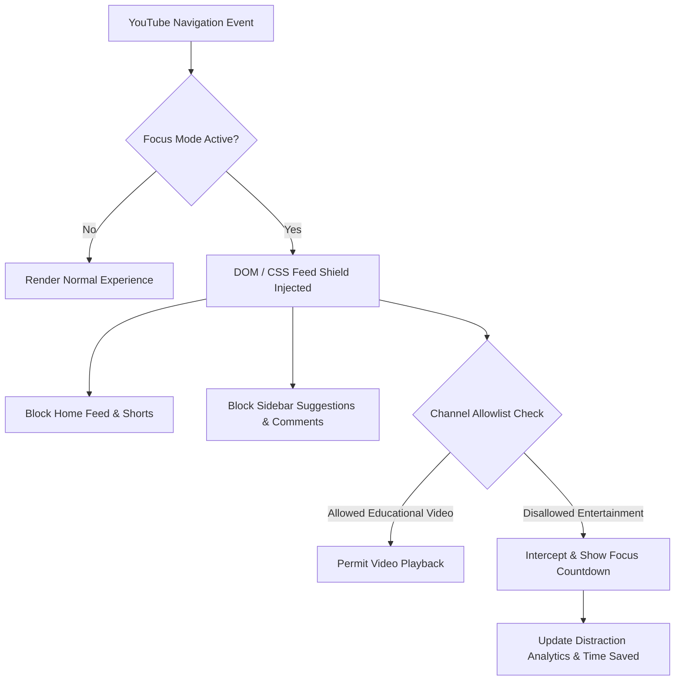

<div align="center">

# 🎯 YouTube Focus

**Distraction-Free YouTube Productivity Engine & Algorithmic Feed Interceptor**

[](https://github.com/flegartech-mvp/youtube-focus/actions)
[](https://www.typescriptlang.org/)
[](https://opensource.org/licenses/MIT)
[](https://vitest.dev/)
[](https://developer.chrome.com/docs/extensions/mv3/)

[**Live Demo**](https://focus.flegartech.com) • [**Chrome Web Store**](https://chromewebstore.google.com) • [**Report Bug**](https://github.com/flegartech-mvp/youtube-focus/issues)

</div>

---

## 📌 Executive Summary

**YouTube Focus** is an open-source productivity suite and Chrome Extension (Manifest V3) designed to dismantle algorithmic addiction loops on YouTube. By selectively intercepting the homepage recommendation feed, endless Shorts loop, and clickbait sidebar carousels, YouTube Focus transforms YouTube from an attention sinkhole into an intentional, distraction-free educational library.

---

## 🎯 Target Persona & Real-World Use Cases

- **Software Engineers & Students:** Watch technical documentation, conferences, and coursework tutorials without falling into algorithmic recommendation traps.
- **Deep Workers & Knowledge Professionals:** Integrate Pomodoro focus sprints with automated feed-blocking shields and intent checks.
- **Self-Directed Learners:** Track aggregate time saved, blocked distraction attempts, and maintain an educational channel allowlist.

---

## 🚀 Live Demo & Interactive Preview

| Distraction Shield in Action | Productivity Analytics Dashboard |
| :---: | :---: |
| [](https://focus.flegartech.com) | [▶ Launch Web Sandbox](https://focus.flegartech.com/dashboard) |

---

## ⚡ Key Engineering Highlights

- **Declarative Feed Interception (Manifest V3):** Zero-lag DOM filtering using pure CSS tokenization and declarative network blocking.
- **Intent-Driven Session State Machine:** Seamless transitions between `IDLE`, `FOCUSING`, `ON_BREAK`, and `COMPLETED`.
- **Productivity & Time-Saved Analytics:** Models reclaimed attention by tracking blocked clickbait triggers and calculating focus efficiency ratios.
- **Strict TypeScript & Zod:** Total runtime type safety for user preferences, custom channel allowlists, and focus telemetry.

---

## 🏗️ System Architecture & Data Pipeline



---

## 🛠️ Quickstart & Local Development

### Prerequisites
- Node.js `20.x` or higher
- `pnpm` `9.x` (recommended) or `npm`

### Installation & Execution

```bash
# 1. Clone the repository
git clone https://github.com/flegartech-mvp/youtube-focus.git
cd youtube-focus

# 2. Install dependencies
pnpm install

# 3. Configure environment variables
cp .env.example .env

# 4. Start local development server
pnpm dev

# 5. Run automated test suite
pnpm test

# 6. Typecheck & linting verification
pnpm typecheck
```

### Loading the Chrome Extension
1. Run `pnpm build` to compile production assets into `dist/`.
2. Open Chrome and navigate to `chrome://extensions/`.
3. Enable **Developer mode** in the top right.
4. Click **Load unpacked** and select the `dist/` directory.

---

## 🧪 Testing & Quality Assurance

```bash
pnpm test:coverage
```

Our Vitest test suite verifies:
- Strict categorization filters for educational vs entertainment content
- Channel allowlist priority overrides
- Session countdown ticking and state machine transitions
- Time-saved metrics calculation and Zod schema validations

---

## 📄 License & Contributing

Distributed under the **MIT License**. Contributions and feature enhancements are welcome!
