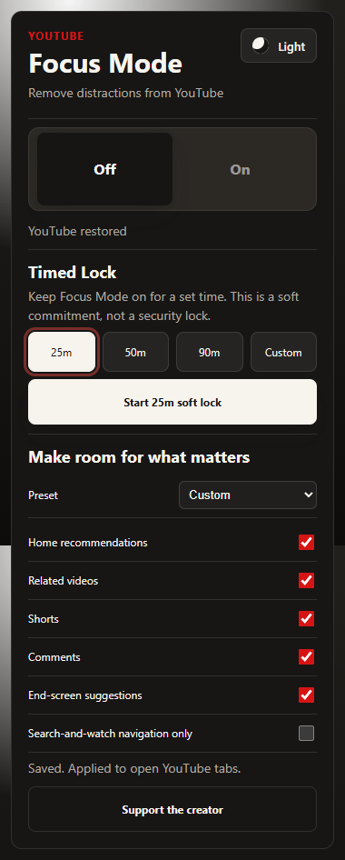

# YouTube Focus Mode

Choose which YouTube surfaces to hide: home recommendations, related videos, Shorts, comments and end-screen cards. Use Classic, Intentional watching or Study presets, a timed soft lock and light/dark themes.

[Chrome Web Store](https://chromewebstore.google.com/detail/feineenlljealpgoohilfdfmocmceohk) · [Repository](https://github.com/flegardev/YouTube-focus)

## Release status

Candidate **3.1.0**; previous version **3.0.3** confirmed from the actual Google update-service package. Upload/submission/publication have not occurred. See [release notes](CHANGELOG.md).

The complete extension is in **`extension/`**. The TypeScript modules in `src/` are retained separately and are not the extension entry point. Full historical source was recovered from PR #1, rather than replacing the product with the incomplete module library.

## Development

Use Node.js 24 and npm.

```sh
cd extension
npm ci
npm run validate
npx playwright install chromium
npm run test:extension
npm run package
```

Run `npm run test:ui` for the popup and route fixture suite. `npm run validate` also checks overlay geometry.

## Load unpacked

Choose `extension` in Chrome → Extensions → Developer mode → Load unpacked. Test with a separate profile. Production upgrades must go to the existing Store item; a different unpacked path can have a different extension ID.

## Architecture and data

Static popup and an isolated YouTube content script. CSS relational selectors handle dynamic recommendations without continuous DOM scanning. Published `focusModeState` and `focusModeTheme` remain unchanged; six boolean controls use `focusModePreferences`. PR #4 was reviewed: its CSS approach was useful, but its incompatible sync schema and missing published lock behavior were not adopted.

## Privacy and permissions

Runtime permissions are unchanged from the recovered published manifest. No analytics backend or remote executable code is added. See [privacy policy](extension/PRIVACY.md). Exports contain private local records; share them only intentionally.

## Limitations

Classic focus preserves the published search-and-watch-only navigation. Disable that explicit setting to retain normal channel navigation. Timed locks are voluntary commitments, not security controls. YouTube can change its DOM; fixture checks do not guarantee every live layout.

## Verification

Automated tests cover actual extension registration, real Chrome storage, legacy-shaped records, restart persistence, user controls and error states. UI fixtures use synthetic, visibly identified sample records. They do not represent the developer’s browsing activity or real car offers. Full live-site playback and all marketplace variants remain manual release checks. Store review/publication are separate from green CI.

## Screenshots

Test fixtures only; these screenshots do not represent real user activity.


